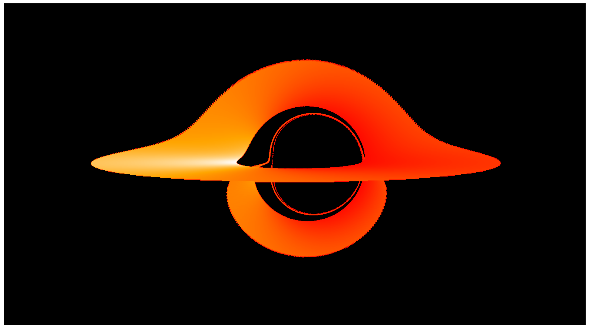
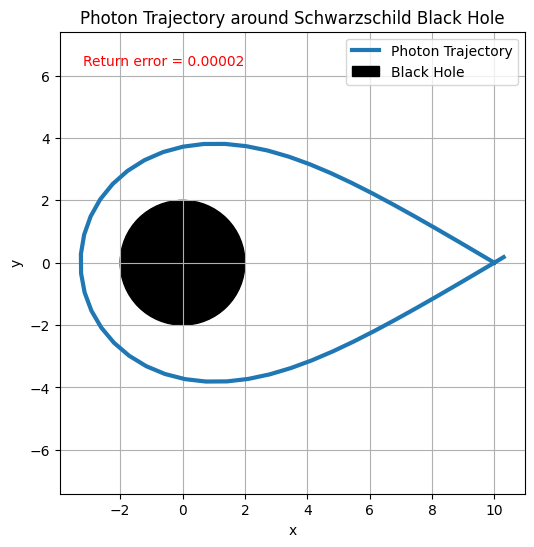
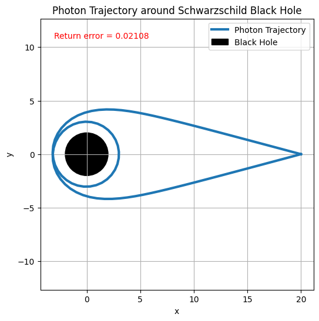

# black-hole-raytracing

```
Relatavistic Ray Tracing
```

# Introduction
This project implements a numerical ray tracer for modeling light propagation in curved spacetime around a black hole. The main program makes images of an accretion disk, accounting for gravitational redshift and relativistic Doppler boosting. You can adjust your viewing angle and distance, as well as spin and mass of the black hole to produce visualisations across various physical parameters.

The project also includes test cases based on Einstein rings, which evaluate the accumulated error in photon trajectories after completing a loops around the ring.



                                 Rendered image of a maximally spinning black hole
# Numerical Methods
Photon trajectories are calculated by numerically integrating the equations of motion in curved spacetime. To integrate these equations of motion, a custom adaptive step RK45 Dormand Prince integrator was used. This method supports high accuracy, dense output, and custom stopping conditions which are crucial for the project.

The trajectories are then used to render the accretion disk while accounting for gravitational redshift and relativistic Doppler boosting. Because the integrator doesn't have a constant step size, a combination of dense output polynomials and root finding (using Newton-Raphson iterations) was used to find precise quantities at the moment the photon hits the disk. 

# Project Structure
- ray_trace.cpp: Main program for accretion disk image creation, parameters can be changed here

- metric.h: Complex metric calculations used in the ray-tracing equations.

- rk45_dromandprince.h, rk45_dormandprince2.h: RK45 Dormand Prince integration implementations.

- newton_raphson.h: Newton-Raphson root-finding implementation.

- accretion.h: Calculations of pixel intensity.

- tests/einstein_ringA.cpp, tests/einstein_ringB.cpp: Einstein ring numerical error tests.

- tests/test_metric.cpp: Metric calculation tests.

# Building and Running

The project requires a C++23-compatible compiler and GNU Make. It was developed and tested using GCC 15.2.0 on macOS.

Build the main program:
```
make
```
Create a ray traced image:
```
make run
```
To make a png image, run the visualize.py file. You will need to change the path to your pgm file.


Compile and run all test programs:
```
make test
```
Compile an individual test:
```
make einstein_A
make einstein_B
make metric_test
```
Remove compiled executables:
```
make clean
```
# Error Evaluation

To evaluate the error we used special orbits called Einstein rings. In this orbit (in General Relativity), a photon launched with specific initial conditions will return to eaxactly to their initial position. We measured the error through computing the difference in radial values between initial and final positions when a photon had returned to its initial angle. Since our integrator takes adaptive steps, we used dense output polynomials and root finding to find the exact time and positions at which our photon returned to the start. 

For our first orbit, the radial error was approximately ```1.6 ×10−5```, while for the second orbit, the error increased to ```0.021```. The higher error in the second orbit is expected because the photon completed an additional loop around the black hole, allowing more numerical error to accumulate. Both results demonstrate that the integrator performs accurately for photon trajectories over large time intervals.
The small fractional errors indicate that the integrator maintains stability and precision across multiple orbits. Further accuracy could be achieved by tightening the relative and absolute tolerances or employing a higher-order adaptive method.


```
Visualizations of our Tests
```



